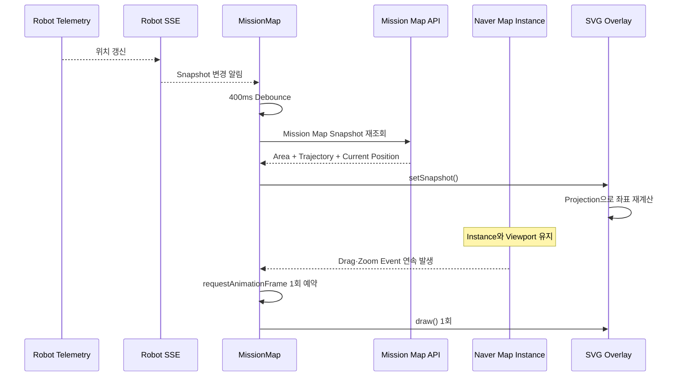

<nav class="project-toc" aria-label="Mission Map 트러블슈팅 목차">
  <p>이 글에서 다루는 내용</p>
  <ol>
    <li><a href="#problem">문제 상황</a></li>
    <li><a href="#cause">원인</a></li>
    <li><a href="#solution">해결 과정</a></li>
    <li><a href="#verification">검증 결과</a></li>
    <li><a href="#limits">한계와 후속 검증</a></li>
  </ol>
</nav>

<h2 id="problem">문제 상황</h2>

Mission 상세는 순찰 구역, 실제 GPS 궤적, 현재 Robot 위치를 같은 지도에
표시한다. Telemetry SSE가 들어올 때마다 상세 화면 전체를 Loading으로 바꾸면서
`MissionMap`이 언마운트됐다. 이때 지도와 Marker가 함께 사라지고 노란색 Loading
Spinner가 잠깐 나타났다 사라졌다. Map이 다시 만들어질 때마다 `fitBounds`도
실행돼 사용자가 맞춘 Zoom과 Viewport가 초기화됐다. 이 Spinner 교체가 당시 약
3초 주기의 SSE마다 반복돼 지도 전체가 깜빡였으며, 이 글에서 제거한 대상은 이 반복
리마운트다.

### SSE 갱신에 따른 화면 전환

수정 전에는 SSE 재조회 중 지도와 마커가 사라지는 구간이 있었다. 재조회가 끝나면
새 지도가 순찰 구역에 맞춰 시점을 다시 잡았다. 수정 후에는 사용자가 이동·확대한
지도를 유지하면서 궤적과 로봇 위치를 갱신했다.

<div class="mission-map-comparison" aria-label="수정 전후 SSE 갱신의 화면 처리 흐름">
  <section aria-labelledby="map-before-title">
    <h4 id="map-before-title">수정 전 · 지도 전체 교체</h4>
    <ol class="mission-map-flow">
      <li><span>갱신 전</span><strong>사용자가 맞춘 지도 표시</strong><p>순찰 구역·궤적·로봇 위치를 표시한다.</p></li>
      <li class="mission-map-flow__interrupted"><span>SSE 수신 · 재조회 중</span><strong>지도·마커 사라짐</strong><p>React가 MissionMap을 제거하고 로딩 Spinner를 표시한다. 정리 함수는 기존 지도를 파괴한다.</p></li>
      <li><span>재조회 완료</span><strong>지도 재생성 · 시점 초기화</strong><p>React가 MissionMap을 다시 마운트한다. 새 지도는 fitBounds로 순찰 구역을 맞춘다.</p></li>
    </ol>
  </section>
  <section aria-labelledby="map-after-title">
    <h4 id="map-after-title">수정 후 · 지도 유지</h4>
    <ol class="mission-map-flow">
      <li><span>갱신 전</span><strong>사용자가 맞춘 지도 표시</strong><p>순찰 구역·궤적·로봇 위치를 표시한다.</p></li>
      <li class="mission-map-flow__preserved"><span>SSE 수신 · 재조회 중</span><strong>지도·마커 계속 표시</strong><p>React가 기존 상세 DOM과 지도 인스턴스를 유지한 채 새 데이터를 조회한다.</p></li>
      <li><span>재조회 완료</span><strong>궤적·위치 갱신 · 시점 유지</strong><p>기존 Overlay에 새 Snapshot을 전달한다. 같은 Mission에서는 fitBounds를 다시 실행하지 않는다.</p></li>
    </ol>
  </section>
</div>

<h2 id="cause">원인</h2>

문제는 좌표 계산이 아니라 **Map과 실시간 데이터의 수명주기를 같게 둔 것**이었다.
Map은 Mission을 선택한 동안 유지해야 하지만 Trajectory와 Marker는 Snapshot마다
바뀌어야 했다. Drag·Zoom·SSE 이벤트마다 전체 궤적을 즉시 다시 계산하면 같은
Browser Frame 안에서 중복 렌더링도 발생할 수 있었다.

### 문제의 코드: Loading 분기에서 MissionMap을 제거했다

`detailLoading`은 지도 생성 Effect의 의존성이 아니었다. 하지만 부모 컴포넌트가
이 값을 조건부 렌더링에 사용해, 상세 정보를 다시 조회할 때마다 `MissionMap`을 DOM에서
제거했다.

```tsx
{detailLoading ? (
  <div className="admin-loading" role="status">
    <span className="loading-spinner" aria-hidden="true" />
    임무 상세와 상태 이력을 불러오는 중입니다.
  </div>
) : detailError ? (
  <div className="page-alert" role="alert">
    {getApiErrorMessage(detailError)}
  </div>
) : selectedMission === null ? (
  <div className="empty-state mission-detail-empty">
    <h3>임무를 선택해주세요.</h3>
  </div>
) : (
  <>
    {/* 임무 진행률과 상세 정보 */}
    <MissionMap
      missionId={selectedMission.missionId}
      missionCode={selectedMission.missionCode}
      patrolAreaName={selectedMission.patrolAreaName}
    />
    {/* 임무 상태 이력 */}
  </>
)}
```

SSE 재조회가 시작돼 `detailLoading`이 `true`가 되면 React는 `MissionMap`을
언마운트하고 지도 생성 Effect의 정리 함수에서 `destroy()`를 실행했다. 조회가
끝나 `false`가 되면 `MissionMap`을 다시 마운트하면서 지도 생성 Effect가 다시
실행됐다.

<h2 id="solution">해결 과정</h2>

해결의 핵심은 **Map 생성과 Snapshot 갱신을 서로 다른 Effect로 분리한 것**이다.
Map 생성 Effect는 지도 인스턴스를 한 번 만들고, Snapshot 갱신 Effect는 기존 지도를
유지한 채 궤적과 현재 위치만 바꾼다.

<ol class="process-flow" aria-label="Mission 지도 문제 해결 과정">
  <li>
    <span>STEP 01</span>
    <strong>상세 DOM을 유지</strong>
    <p>SSE 재조회 중 기존 상세를 Spinner로 교체하지 않고 현재 화면 위에서 Snapshot을 갱신했다.</p>
  </li>
  <li>
    <span>STEP 02</span>
    <strong>Map 생성과 Snapshot 갱신 분리</strong>
    <p>Map 생성 Effect와 Snapshot 갱신 Effect를 나누고, Area·Trajectory·Marker는 하나의 React SVG Overlay에서 갱신했다.</p>
  </li>
  <li>
    <span>STEP 03</span>
    <strong>Drag·Zoom 좌표 재투영</strong>
    <p>지도 이동과 확대 이벤트에서 지리 좌표를 화면 좌표로 다시 계산했다.</p>
  </li>
  <li>
    <span>STEP 04</span>
    <strong>Browser Frame 단위로 병합</strong>
    <p>연속 이벤트는 <code>requestAnimationFrame</code>당 한 번만 최신 Projection으로 그렸다.</p>
  </li>
</ol>

<div class="flow-strip" aria-label="Mission 지도 갱신 흐름">
  <div><span>KEEP</span><strong>Map 1개</strong><small>Mission 수명주기</small></div>
  <i aria-hidden="true">+</i>
  <div><span>KEEP</span><strong>SVG Overlay 1개</strong><small>Map에 부착</small></div>
  <i aria-hidden="true">←</i>
  <div><span>UPDATE</span><strong>REST Snapshot</strong><small>SSE·Drag·Zoom</small></div>
  <i aria-hidden="true">←</i>
  <div><span>MERGE</span><strong>Animation Frame</strong><small>Frame당 1회</small></div>
</div>

### 구현 컴포넌트별 책임

| 컴포넌트·함수 | 역할 |
| --- | --- |
| `MissionManagePage` | SSE 재조회 중에도 기존 Mission 상세 DOM을 유지하고 새 상세 Snapshot만 교체한다. |
| `MissionMap` | SSE를 변경 신호로 받아 400ms 안에 연속된 알림을 하나의 Mission Map REST 재조회로 병합한다. |
| `MissionNaverMap` | 같은 Mission을 보는 동안 Naver Map Instance와 Viewport를 유지한다. |
| `createMissionMapOverlay()` · `MapAttachedMissionOverlay` | `MissionMapOverlay` 타입을 구현한 Overlay를 생성하고, Area·Trajectory·현재 위치를 하나의 SVG Layer에서 최신 Snapshot으로 다시 그린다. |
| `scheduleOverlayRedraw` | Drag·Zoom에서 발생한 여러 Map Event를 다음 Animation Frame의 `draw()` 한 번으로 합친다. |

`MissionMapOverlay`는 `setSnapshot()`을 포함한 Overlay 타입이다.
`createMissionMapOverlay()` 팩토리 함수가 이 타입을 구현한
`MapAttachedMissionOverlay` 인스턴스를 생성한다.



### Map과 Overlay의 역할을 나눴다

Map SDK는 배경 Tile과 좌표 Projection만 담당한다. 순찰 구역, 궤적, 현재 위치는
Map에 부착된 하나의 React SVG Overlay에서 그린다. SSE는 Snapshot REST를 다시
읽게 하지만, 같은 Mission을 보는 동안 Map Instance와 사용자가 맞춘 Viewport는
유지한다.

<figure class="verification-shot verification-shot--media-crop">
  <a href="{{ '/VEDEOS/GIMBOM-MISSION.gif' | relative_url }}">
    
  </a>
  <figcaption>
    <span>LIVE TRAJECTORY UPDATE</span>
    <strong>지도 화면을 유지한 궤적 갱신</strong>
    <p>궤적 좌표 수가 44개에서 47개로 늘고 현재 위치가 이동하는 동안 Loading 화면으로 바뀌지 않고 같은 Zoom과 Viewport를 유지한다.</p>
  </figcaption>
</figure>

<h4>백그라운드 재조회 중에도 기존 상세 DOM을 유지한다</h4>

`detailLoading`만으로 전체 상세를 Spinner로 교체하지 않는다. 처음 열어 아직
`selectedMission`이 없을 때만 Loading을 표시하고, 기존 상세가 있으면 Map을 그대로
둔 채 새 응답으로 상태만 교체한다.

```typescript
/* MissionManagePage.tsx · Mission 상세 Snapshot */
const loadMissionDetail = useCallback(async (missionId: string) => {
  requestedDetailIdRef.current = missionId
  setDetailLoading(true)
  setDetailError(null)
  try {
    const [mission, statusHistory] = await Promise.all([
      getMission(missionId),
      getMissionHistory(missionId),
    ])
    if (requestedDetailIdRef.current !== missionId) {
      return
    }
    setSelectedMission(mission)
    setHistory(statusHistory.history)
  } finally {
    if (requestedDetailIdRef.current === missionId) {
      setDetailLoading(false)
    }
  }
}, [])

// ... JSX ...
{detailLoading && selectedMission === null ? (
  <div className="admin-loading" role="status">
    임무 상세와 상태 이력을 불러오는 중입니다.
  </div>
) : selectedMission === null ? (
  <div className="empty-state mission-detail-empty">
    임무를 선택해주세요.
  </div>
) : (
  <MissionMap
    missionId={selectedMission.missionId}
    missionCode={selectedMission.missionCode}
    patrolAreaName={selectedMission.patrolAreaName}
  />
)}
```

<h3>핵심: Map 생성과 Snapshot 갱신을 서로 다른 Effect로 분리한다</h3>

첫 번째 Effect는 Map을 한 번 생성하고 Component가 실제로 해제될 때만
`destroy()`한다. 두 번째 Effect는 `snapshot`이 바뀌어도 기존 Map과 Overlay를
재사용한다. `fitBounds`도 Mission ID가 달라질 때만 실행하므로 Telemetry 갱신이
사용자의 Zoom을 초기화하지 않는다.

```typescript
/* MissionMap.tsx · MissionNaverMap */
const mapRef = useRef<naver.maps.Map | null>(null)
const fittedMissionIdRef = useRef<string | null>(null)
const initialSnapshotRef = useRef(snapshot)
const missionOverlayRef = useRef<MissionMapOverlay | null>(null)

useEffect(() => {
  // ... Naver SDK와 Projection 준비 ...
  const { maps } = window.naver
  const initialSnapshot = initialSnapshotRef.current
  const initialCoordinates = missionViewportCoordinates(initialSnapshot)
  const [centerLongitude, centerLatitude] = coordinateCenter(
    initialCoordinates,
  )
  const map = new maps.Map(mapElementRef.current, {
    center: new maps.LatLng(centerLatitude, centerLongitude),
    zoom: initialCoordinates.length === 1 ? 17 : 15,
  })
  mapRef.current = map

  return () => {
    missionOverlayRef.current?.setMap(null)
    missionOverlayRef.current = null
    mapRef.current?.destroy()
    mapRef.current = null
    fittedMissionIdRef.current = null
  }
}, [])

useEffect(() => {
  if (status !== 'ready' || mapRef.current === null || !window.naver) {
    return
  }
  const map = mapRef.current
  if (missionOverlayRef.current === null) {
    missionOverlayRef.current = createMissionMapOverlay(
      window.naver.maps,
      mapElementRef.current as HTMLElement,
      snapshot,
    )
    missionOverlayRef.current.setMap(map)
  } else {
    missionOverlayRef.current.setSnapshot(snapshot)
  }

  if (fittedMissionIdRef.current !== snapshot.missionId) {
    fitMapToCoordinates(
      map,
      window.naver.maps,
      missionViewportCoordinates(snapshot),
    )
    fittedMissionIdRef.current = snapshot.missionId
  }
}, [snapshot, status])
```

<h4>SSE 여러 건을 Map Snapshot 한 번으로 다시 읽는다</h4>

SSE Payload로 지도 좌표를 직접 수정하지 않는다. SSE는 데이터가 변경됐다는
알림으로만 사용한다. 알림을 받으면 Frontend가
`GET /api/v1/missions/{missionId}/map?limit=5000`을 호출해 Backend DB에 저장된
순찰 구역, 궤적과 현재 위치를 다시 가져온다.
400ms 안에 Event가 연속으로 오면 앞 Timer를 취소해 마지막 한 번만 조회하며, 늦게
끝난 이전 요청은 `requestSequenceRef` 비교로 화면을 덮지 못한다.

```typescript
/* MissionMap.tsx · Mission Snapshot 재조회 */
const loadSnapshot = useCallback(async () => {
  const sequence = requestSequenceRef.current + 1
  requestSequenceRef.current = sequence
  const result = await getMissionMap(missionId)

  if (requestSequenceRef.current === sequence) {
    setSnapshot(result)
    setLastSyncedAt(new Date().toISOString())
  }
}, [missionId])

const scheduleSnapshot = useCallback(() => {
  if (refreshTimerRef.current !== null) {
    window.clearTimeout(refreshTimerRef.current)
  }
  refreshTimerRef.current = window.setTimeout(() => {
    refreshTimerRef.current = null
    void loadSnapshot()
  }, SNAPSHOT_DEBOUNCE_MILLIS) // 400ms
}, [loadSnapshot])

useRobotRealtime(scheduleSnapshot)
```

문제가 발생했을 당시 Telemetry 주기는 약 3초로 400ms 디바운스보다 길었기 때문에
재조회가 계속 밀리지는 않았다. 400ms보다 짧은 간격으로 SSE가 끊임없이 들어오는
환경이라면 trailing debounce의 타이머가 계속 초기화될 수 있으므로, 최대 대기 시간을
둔 throttle로 바꿔야 한다.

### 이벤트를 한 Browser Frame으로 병합했다

`drag`, `panning`, `zooming`, `bounds_changed`, `zoom_changed`, `idle`을 같은
재투영 경로로 연결했다. 예약된 Frame이 있으면 추가 예약을 생략하고
`requestAnimationFrame`당 한 번만 최신 Projection으로 Area·Trajectory·Marker를
함께 갱신한다.

```typescript
/* MissionMap.tsx · MissionNaverMap Viewport Event */
useEffect(() => {
  if (status !== 'ready' || mapRef.current === null || !window.naver) {
    return
  }
  const { maps } = window.naver
  const map = mapRef.current
  let redrawFrame: number | null = null

  const scheduleOverlayRedraw = () => {
    if (redrawFrame !== null) {
      return
    }
    redrawFrame = window.requestAnimationFrame(() => {
      redrawFrame = null
      missionOverlayRef.current?.draw()
    })
  }

  const viewportEvents = [
    'drag',
    'panning',
    'zooming',
    'bounds_changed',
    'size_changed',
    'zoom_changed',
    'dragend',
    'idle',
  ] as const
  const listeners = viewportEvents.map((eventName) => (
    maps.Event.addListener(map, eventName, scheduleOverlayRedraw)
  ))

  return () => {
    listeners.forEach((listener) => maps.Event.removeListener(listener))
    if (redrawFrame !== null) {
      window.cancelAnimationFrame(redrawFrame)
    }
  }
}, [status])
```

`draw()`는 그 시점의 Naver Projection으로 Area Polygon, 전체 Trajectory와 현재
Robot Marker를 같은 Frame에서 재투영한다. Event 수만큼 렌더링하는 것이 아니라
Browser가 실제로 그릴 Frame 수에 맞춰 갱신 횟수를 제한한다.

<h2 id="verification">검증 결과</h2>

2026년 8월 1일 Overlay 재투영·확대 클리핑 수정 기록에서 Mission Map Chromium E2E
1건과 전체 Mission Chromium E2E 3건이 통과했다. 테스트는 연속 Viewport Event 뒤
Application Listener가 경계와 Marker를 갱신하는지, SVG의 `overflow` 속성과 계산된
CSS 값이 모두 `visible`인지 검사했다.

지도 좌표 재투영과 SVG 내부 클리핑을 별도로 처리했다. 내부 SVG는 전체 형상을
보존하고, 바깥 지도 Card는 `overflow: hidden`으로 지도 밖 출력을 제한한다.

<h2 id="limits">한계와 후속 검증</h2>

- 프로젝트 개발 당시 Chromium E2E는 Naver SDK Adapter로 지도 계약을 검사했다.
- EC2 HTTPS의 실제 지도 조작과 Jetson GPS 장시간 궤적은 검증에 포함하지 않았다.
- 궤적 좌표가 많아지면 Frame당 한 번의 전체 재투영도 비용이 커질 수 있다. 장시간
  순찰에는 점 단순화나 Downsampling이 추가로 필요하다.

<h2 id="sources">근거 문서</h2>

- `TROUBLESHOOTING/11_MissionMap.md`
- `CHANGLOGS/2026-07-30_1243_mission-map.md`
- `CHANGLOGS/2026-07-30_2303_mission-map-svg-flicker.md`
- `CHANGLOGS/2026-08-01_2153_mission-map-drag-overlay.md`
- `CHANGLOGS/2026-08-01_2241_mission-map-viewport-zoom.md`
- `CHANGLOGS/2026-08-01_2308_mission-map-attached-overlay.md`
- `CHANGLOGS/2026-08-01_2327_mission-map-realtime-overlay-redraw.md`
- `CHANGLOGS/2026-08-01_2335_mission-map-zoom-clip.md`
